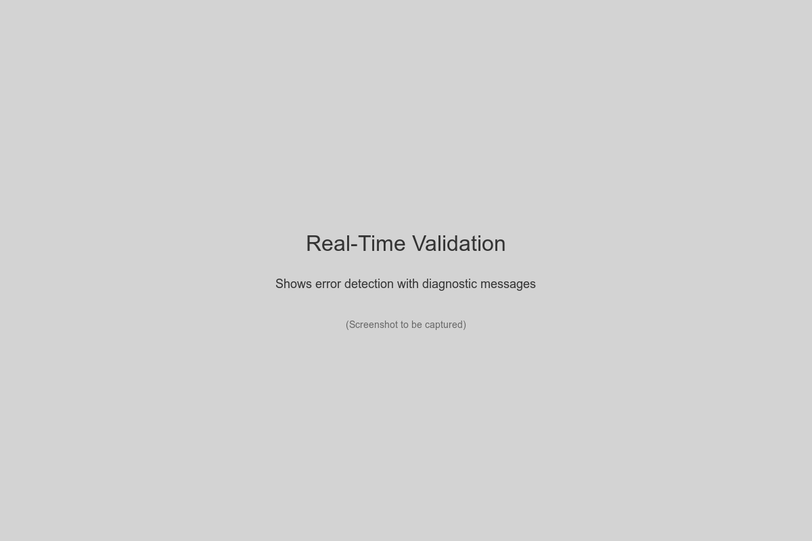
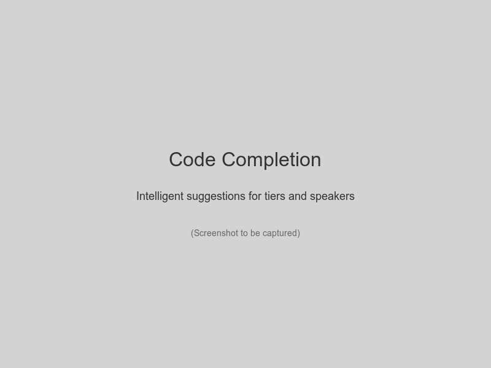
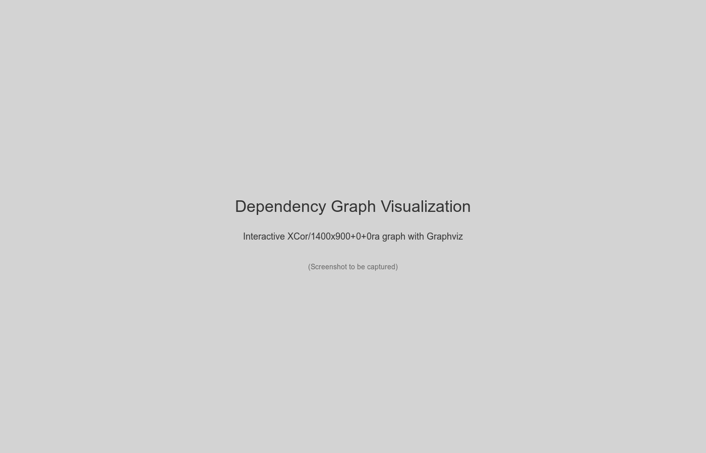

# TalkBank CHAT for VS Code

**Status:** Current
**Last updated:** 2026-11-13

Editing and analysis support for CHAT transcription files (`.cha`), the format used by [TalkBank](https://talkbank.org), [CHILDES](https://childes.talkbank.org), and related corpora for linguistic research on conversational data.

This extension is maintained as a VS Code editor and a concrete consumer of Chatter's language-server contract. CLAN analysis uses the composed `chatter-clan-lsp` Rust server.

## Screenshots

| Feature | Preview |
|---------|---------|
| Real-time validation |  |
| Intelligent completion |  |
| Dependency graph (`%gra`) |  |

## Features

### Real-Time Validation

Errors and warnings appear as you type. The language server validates syntax, required headers, participant declarations, tier alignment, morphology format, grammar relations, timing bullets, and terminators, then shows diagnostics in the editor and Problems panel.

### Cross-Tier Alignment

Hover over any word to see how it aligns across annotation layers. Click a word and all its aligned elements on `%mor`, `%gra`, `%pho`, and other tiers highlight simultaneously.

### Syntax Highlighting

Full TextMate grammar plus semantic tokens from the language server. Headers, speaker codes, dependent tiers, annotations, morphology, grammar relations, pauses, and timing bullets are all distinctly colored.

### Dependency Graph Visualization

Press `Cmd+Shift+G` to render the `%gra` dependency structure of the current utterance as a color-coded graph. Arcs are labeled with grammatical relations (SUBJ, OBJ, DET, MOD, ROOT, etc.) and colored by type. Export as SVG or PNG.

### CLAN Analysis

CLAN analysis runs in `chatter-clan-lsp`, a composed Rust server linking
Chatter's editor library and the `talkbank-clan` analysis library. Select its
binary with `talkbank.lsp.binaryPath`, or use a VSIX that bundles it. The server
advertises the available commands and required prompts. The core editor RPCs
remain owned by Chatter. Library differences and historical audit snapshots are tracked in the
[chatter-clan parity record](https://talkbank.github.io/chatter-clan/parity-status.html).

### Participant Editor

Edit `@ID` headers visually in a table with editable columns for all 10 pipe-delimited fields. Parsing and serialization are fully delegated to the language server.

### Media Playback

Play audio or video linked via `@Media:` headers. **Play at Cursor** (`Cmd+Shift+Enter`) plays the segment nearest the cursor. **Continuous Play** (`Cmd+Shift+/`) plays from cursor to end, tracking the current utterance in the editor. Adjustable playback speed (0.25x-2x). Segment timing is loaded from the language-server alignment sidecar when available, with local bullet parsing as fallback.

### Waveform View

Press `Cmd+Shift+W` to open a waveform visualization of the linked media. Colored overlays mark each timed utterance. Click anywhere on the waveform to seek both the audio and the editor cursor. Zoom in/out with toolbar buttons or mouse wheel; the view auto-scrolls during playback.

### Picture Display

Show elicitation pictures (Cookie Theft, etc.) alongside the transcript. The extension finds images from `%pic:` references, same-name files, or the document directory.

### Coder Mode

Load a `.cut` codes file and step through uncoded utterances. Select codes from a hierarchical QuickPick to insert `%cod:` tiers. `Cmd+Enter` advances to the next uncoded utterance.

### Transcription Mode

Start transcription mode from the Command Palette. Type while audio plays, then press `F4` to stamp a timing bullet and advance to a new utterance line. Configurable default speaker code and rewind interval.

### Walker Mode

Step through utterances one at a time with `Alt+Down` / `Alt+Up`. Each step moves the cursor and plays the corresponding audio segment.

### Speaker Filtering

Filter the transcript to show only selected speakers. Choose one or more speaker codes and a filtered view opens in a side-by-side panel.

### Special Character Input

Insert 50+ CA and CHAT special characters via compose-key mode. Press `Cmd+Shift+1` for Conversation Analysis symbols (intonation arrows, overlap brackets, creaky, whisper, etc.) or `Cmd+Shift+2` for CHAT symbols (IPA, diacritics, glottal stop, etc.). The next keystroke inserts the corresponding Unicode character.

### Code Completion

Context-aware suggestions for speaker codes (from `@Participants`), dependent tier prefixes (`%mor`, `%gra`, `%pho`, etc.), and postcode punctuation. Header completion triggers on `@` and bracket completion triggers on `[` for rapid annotation entry.

### Quick Fixes

Quick fixes come from the selected server's current diagnostics and repair catalog. They require versioned workspace-edit support. Review each proposed edit before applying it. Enter missing participant identities, roles and languages explicitly.

### On-Type Formatting

As you type, the extension auto-indents continuation lines with tabs, keeping dependent tiers properly aligned without manual intervention.

### Document Formatting

Format to canonical CHAT style with `Shift+Alt+F`. Normalizes whitespace, header ordering, and tier indentation.

### Rename Speaker

Press `F2` on a speaker code to rename it across `@Participants`, `@ID` headers, and all main tier lines in one operation. Linked editing keeps matching speaker codes in sync as you type.

### Workspace Symbols

Press `Cmd+T` to search across all open CHAT files by speaker code and utterance content.

### Document Links

`@Media:` header values are clickable links that open the referenced media file.

### Smart Selection

Use `Shift+Ctrl+Right` (expand) / `Shift+Ctrl+Left` (shrink) to grow or shrink the selection by syntactic units, word, utterance, tier block, and transcript.

### Find All References

`Shift+F12` on a speaker code lists every occurrence: declaration, `@ID` header, and all main tier lines.

### Code Lens

Utterance counts per speaker are shown above the `@Participants` header (e.g., `CHI: 42 utterances`).

### Snippets

8 CHAT snippets for common structures: header block (`@UTF8`/`header`/`newfile`), `@Participants`, `@ID`, main tier, `%mor`, `%gra`, `@Comment`, and Gem (`@Bg`/`@Eg`). Type the prefix and press `Tab`.

### Go to Definition

`F12` or `Cmd+Click` jumps from speaker codes to their `@Participants` declaration, and from `%mor` or `%gra` items to the aligned main tier word.

### Hover

Hover over headers (`@Participants`, `@ID`, etc.) and timing bullets to see contextual documentation and alignment details.

### Inlay Hints

Inline annotations show alignment count mismatches (e.g., `[alignment: 3 main <-> 2 mor]`) without modifying the file.

### Validation Explorer

A tree view in the Explorer sidebar for bulk validation of entire directories. Cached results in SQLite speed up repeated runs across large corpora.

### CLAN Integration

If the CLAN application is installed, open any `.cha` file directly in CLAN at the current cursor position via Apple Events (macOS) or Windows messaging.

## Keyboard Shortcuts

| Shortcut | Action |
|----------|--------|
| `Cmd+Shift+G` | Show Dependency Graph |
| `Cmd+Shift+Enter` | Play Media at Cursor |
| `Cmd+Shift+/` | Play Media Continuously |
| `Cmd+Shift+W` | Show Waveform View |
| `Alt+Down` / `Alt+Up` | Walker: Next / Previous Utterance |
| `F8` | Rewind Media |
| `Shift+F5` | Toggle Segment Loop |
| `F4` | Stamp Timestamp Bullet (transcription mode) |
| `Cmd+Shift+1` | Insert CA Special Character |
| `Cmd+Shift+2` | Insert CHAT Special Character |
| `F2` | Rename Speaker Code |
| `Shift+F12` | Find All References |
| `F12` / `Cmd+Click` | Go to Definition |
| `Cmd+.` | Quick Fix |
| `Shift+Alt+F` | Format Document |
| `Cmd+T` | Workspace Symbol Search |

On Windows/Linux, substitute `Ctrl` for `Cmd`.

## Scope and CLAN parity

Full feature parity with the macOS CLAN application is a paused long-term goal.
This update maintains the editor and restores 34 library analysis commands.
Most command options use library defaults. Custom scoring-rule controls,
annotation tools, converter/transform workflows, complete application-workflow
comparison and further native-platform qualification remain open. Real normative
database comparisons and command-specific C CLAN output parity need additional
evidence. The [parity and remaining-work inventory](book/src/developer/clan-parity.md)
records the current coverage, concrete gaps and completed qualification.

## Requirements

- VS Code 1.146 or later (matches `engines.vscode` in `package.json`)
- A platform-specific VSIX built by this repository bundles the composed editor server under `server/`. Local development can select its absolute path through `talkbank.lsp.binaryPath`.

The extension searches for `talkbank-lsp` on your system PATH first, then falls back to `target/debug/` and `target/release/` relative to the extension directory.

## Settings

| Setting | Default | Description |
|---------|---------|-------------|
| `talkbank.bullets.display` | `"dim"` | Bullet display mode: `"dim"`, `"hidden"`, or `"normal"` |
| `talkbank.walker.autoPlay` | `true` | Auto-play media when stepping with walker |
| `talkbank.walker.loopCount` | `1` | Loop count per segment (0 = indefinite) |
| `talkbank.walker.pauseSeconds` | `0` | Pause between segments during continuous play |
| `talkbank.walker.walkLength` | `0` | Utterances to play continuously (0 = all) |
| `talkbank.media.defaultSpeed` | `100` | Playback speed percentage (25-200) |
| `talkbank.inlayHints.enabled` | `true` | Show inline alignment mismatch hints |
| `talkbank.validation.severity` | `"all"` | Filter diagnostics: `"all"`, `"errorsOnly"`, `"errorsAndWarnings"` |
| `talkbank.lsp.binaryPath` | (auto) | Override path to the `talkbank-lsp` binary |

## Documentation

All documentation lives in the **[TalkBank CHAT Editor book](../book/src/introduction.md)** (mdBook). Entry points:

- [Getting Started](book/src/getting-started/installation.md): install a platform VSIX and open your first file
- [Editing](book/src/editing/syntax-highlighting.md) / [Navigation](book/src/navigation/alignment.md) / [Media & Transcription](book/src/media/playback.md), feature chapters
- [Developer Guide](book/src/developer/architecture.md): three-layer architecture, LSP internals, adding features
- [CLAN Parity and Remaining Work](book/src/developer/clan-parity.md): current coverage, paused goal and concrete gaps

## Links

- [TalkBank](https://talkbank.org): home of the TalkBank project
- [CHILDES](https://childes.talkbank.org): Child Language Data Exchange System
- [CHAT Manual](https://talkbank.org/0info/manuals/CHAT.html): official CHAT format specification
- [Issue Tracker](https://github.com/TalkBank/chatter/issues)
