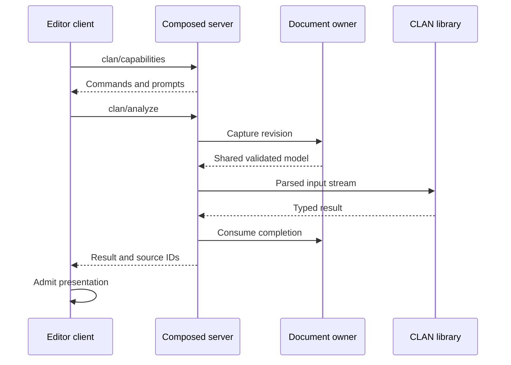

# Running CLAN Commands

**Status:** Current
**Last updated:** 2026-11-13

CLAN analysis runs in `chatter-clan-lsp`, a composed Rust server linking
Chatter's editor library and the `talkbank-clan` analysis library. Select its
binary with `talkbank.lsp.binaryPath`, or use a VSIX that bundles it. The server
advertises the available commands and required prompts. The core editor RPCs
remain owned by Chatter. Command coverage and numerical parity follow the
[chatter-clan parity record](https://talkbank.github.io/chatter-clan/parity-status.html).

## Pipeline

A document request uses the current unsaved buffer. A directory request discovers
CHAT files once and streams one admitted model at a time into one aggregate.
Open files in that population use their editor revisions. Traversal or input
admission failures reject the request. An edit or close/reopen invalidates a
pending editor result. Cancel through the progress notification.

## Running an analysis on a single file

1. Open a `.cha` file in the editor.
2. Right-click anywhere in the editor and choose **Run CLAN Analysis...**,
   or open the Command Palette (`Cmd+Shift+P` / `Ctrl+Shift+P`) and
   select **TalkBank: Run CLAN Analysis**.
3. A QuickPick list shows the commands advertised by the selected server.
4. Select a command. If the command requires additional input (see below),
   a follow-up dialog appears.
5. Results open in a styled side panel with stat cards, tables, and
   proportional bar charts.

## Running an analysis on a directory

To analyze all `.cha` files in a directory at once:

1. In the Explorer sidebar, right-click a folder.
2. Choose **Run CLAN Analysis on Directory...**.
3. Select an analysis command from the picker.
4. The language server walks the directory tree recursively and runs
   the command on every `.cha` file it finds.
5. Results from all files are aggregated in a single analysis panel.

This is equivalent to CLAN's batch-mode directory analysis and is
useful for computing corpus-wide statistics such as total vocabulary
or mean MLU across participants.

## The analysis panel

Results display in a WebviewPanel with several presentation elements:

- **Stat cards** at the top showing key numeric results (e.g., MLU value,
  type-token ratio, total word count) with color-coded indicators.
- **Tables** with sortable columns for detailed breakdowns (e.g., word
  frequencies, speaker-level statistics).
- **Proportional bar charts** for visual comparison of values across
  speakers or categories.

## Exporting results as CSV

Click the **Export CSV** button in the analysis panel toolbar.
A save dialog appears where you choose the output location and filename.
The CSV file includes:

- All stat card values as key-value rows.
- All visible tables with their column headers.

The CSV format is compatible with Excel, Google Sheets, R (`read.csv()`),
and Python (`pandas.read_csv()`). For longitudinal studies, export
results from multiple files and combine them in a spreadsheet.

## Commands that prompt for additional input

The following commands require information beyond the `.cha` file itself.
After selecting one of these commands, a follow-up dialog appears:

| Command | Input type | What to provide |
|---------|-----------|-----------------|
| **kwal** | Text input box | One or more keywords, space-separated. The command finds all utterances containing any of the keywords. |
| **combo** | Text input box | A Boolean search expression. Use `+` for AND (`want+cookie` finds utterances with both words) and `,` for OR (`want,milk` finds utterances with either word). |
| **keymap** | Text input box | Keyword codes, space-separated. Used for contingency mapping of coded behaviors. |
| **mortable** | File picker | A morpheme script file (`.cut`) defining the morpheme categories to tabulate. |
| **script** | File picker | A template CHAT file (`.cha`) to compare the current transcript against. |
| **rely** | File picker | A second CHAT file (`.cha`) for computing inter-rater reliability. |

For `mortable`, `script`, and `rely`, the file picker dialog opens
to the current workspace folder by default. You can navigate to any
location on disk.

## Tips

- **Run the same command on multiple files** by using the directory
  analysis option. This is faster than running the command file by file.
- **Compare speakers** within a single file: most commands (FREQ, MLU,
  MLT, VOCD) break results out per speaker automatically.
- **Save CSV exports** with consistent naming conventions for
  longitudinal data collection (e.g., `CHI_freq_session01.csv`).

## Next steps

- [Profiling Commands](profiling.md) -- MLU, MLT, VOCD, DSS, IPSyn
- [Frequency & Distribution](frequency.md) -- FREQ, WDLEN, MAXWD, and more
- [Assessment Tools](assessment.md) -- KidEval, Eval, Eval-D
- [Command Reference](command-reference.md) -- the analysis commands in one table
