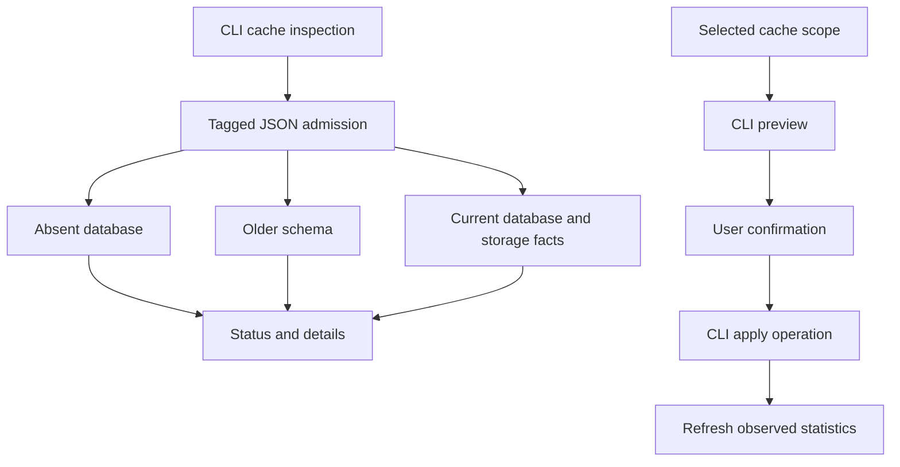

# Cache Management

**Status:** Current
**Last updated:** 2026-11-13

Chatter's CLI owns its validation cache. The extension polls
`chatter cache stats --format json` every five seconds and uses Chatter's cache
commands for maintenance. Install the current `chatter` CLI separately for
these features. The bundled composed language server supplies editor and CLAN
analysis RPCs.

## Cache observations

Click the cache status-bar indicator or run **TalkBank: View Cache Statistics**.
The current wire contract distinguishes three observations.

- An absent database shows its cache directory.
- An older schema shows its directory and migration status.
- A current database shows its measured entry count, directory, file size and
  modification time. In-memory storage and a missing database file retain
  their explicit absence values.

An unavailable CLI, unreadable cache or refused response shows **Unavailable**.
Valid, invalid and expired counts and a hit-rate breakdown have no fields in
this wire contract.

## Clearing entries

In the Validation Explorer, right-click a file or directory and select
**Clear Cache**. The extension requests a preview, shows the returned count,
then asks for confirmation before applying the operation.

Run **TalkBank: Clear All Validation Cache** to confirm removal of every entry.
Both operations use the CLI's database owner. The resulting native message
reports what was cleared.

The equivalent CLI operations are

```bash
chatter cache clear --prefix path/to/corpus/
chatter cache clear --prefix path/to/corpus/ --apply
chatter cache clear --all --apply
```

The first command previews. `--apply` performs the removal. To refresh validation
for one run, use

```bash
chatter validate path/to/corpus/ --refresh-cache
```

## Cache ownership

The CLI chooses the operating-system cache directory and owns inspection,
schema migration and mutation. Cache statistics are a read-only observation.
An older schema migrates during a writing operation. Use the current CLI's
help and [Chatter cache documentation](https://talkbank.github.io/chatter/chatter/user-guide/cli-reference.html)
for its validation-policy and reuse rules.



## Related Chapters

- [Corpus Validation](../workflows/corpus-validation.md)
- [Settings Reference](settings.md)
