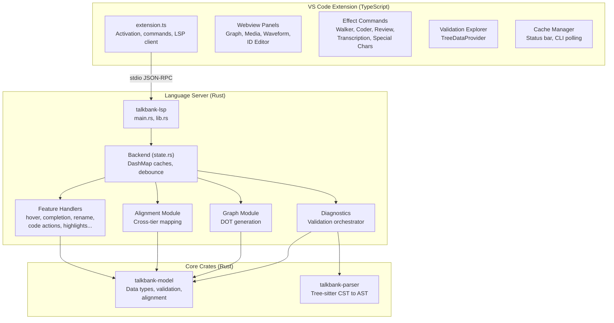
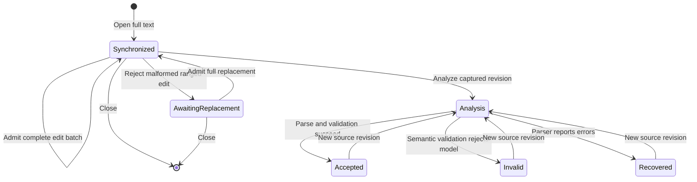
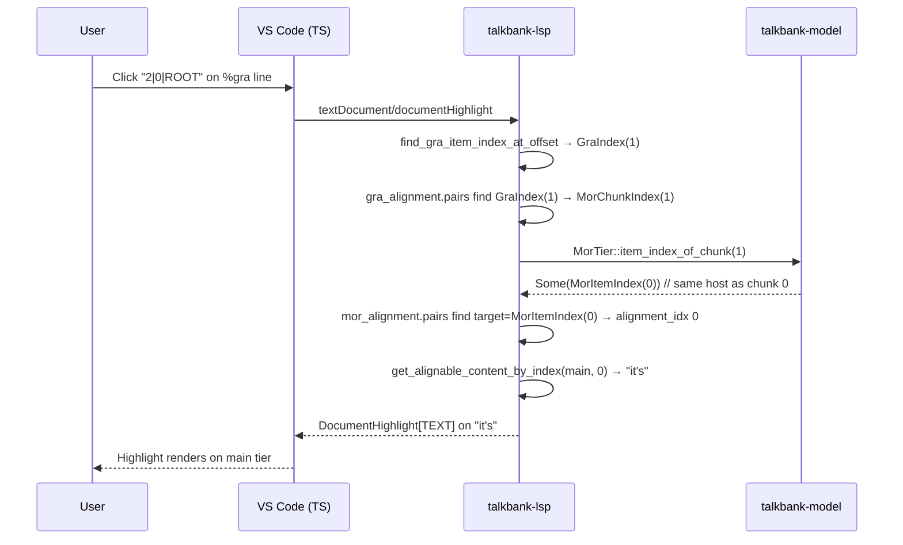
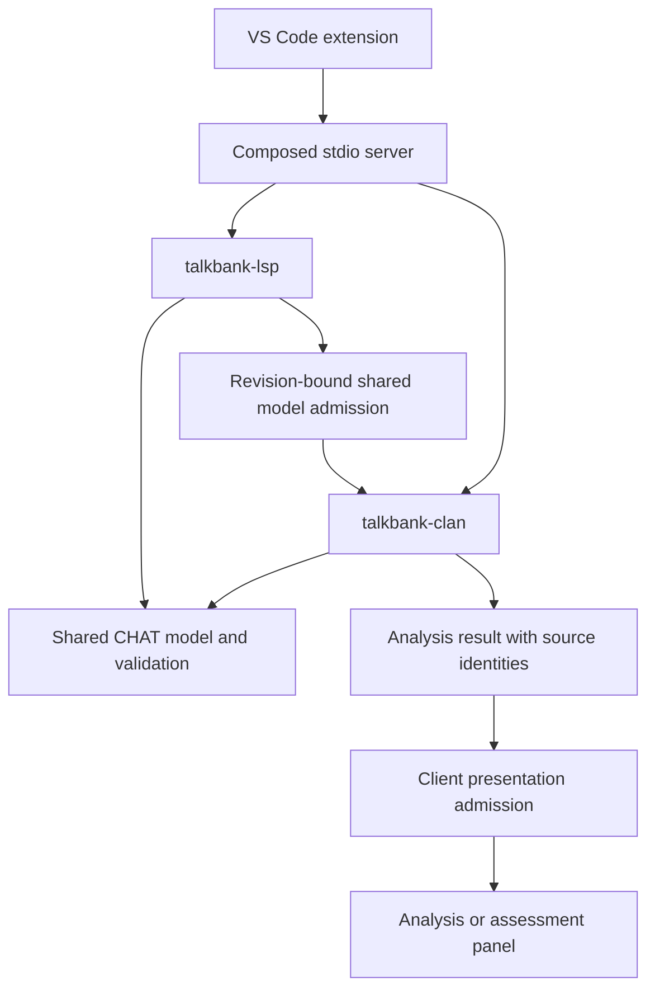
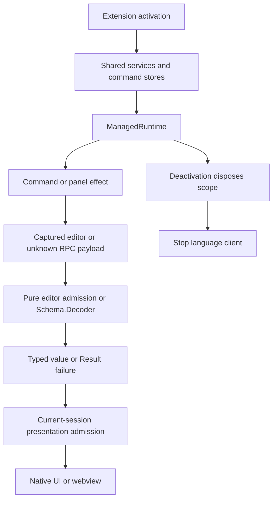
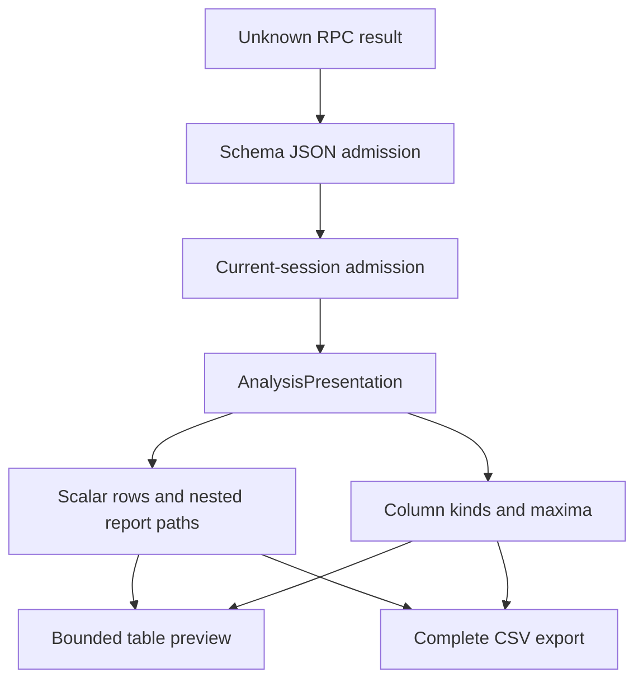
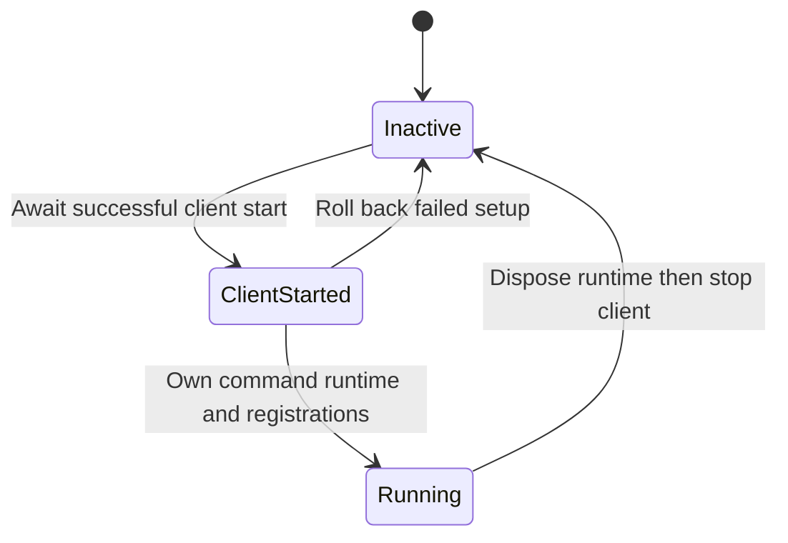

# Architecture

**Status:** Current
**Last modified:** 2026-11-13

This chapter describes the internal architecture of the TalkBank CHAT VS Code extension and its backing language server. It is written for developers who want to understand or contribute to the codebase.

## Three-Layer Architecture

The system is split into three layers, each with a clear responsibility:



**Key principle:** the LSP server is a presentation layer. All parsing, validation, and alignment computation lives in `talkbank-model` and `talkbank-parser`. The LSP crate formats and routes that information to the VS Code client. The TypeScript extension is a thin UI layer that registers commands, manages webviews, and communicates with the LSP over stdio.

## Document Lifecycle

An open document has a synchronized revision or an awaiting-replacement state.
The revision owns its source and version. Its `Arc` identity distinguishes a
close/reopen cycle even when the URI, text and version repeat.



Changes debounce for 250 ms. A superseded scheduled validation cannot publish
against a newer session. Saving requests validation immediately. Invalid and
recovered models can serve editing features for their exact source. CLAN
analysis requires the accepted variant's retained validation proof.

## Backend State

`Backend` shares document sessions, source-bound `DocumentAnalysis` snapshots,
pending validation identifiers and versioned-edit capability admission. Its
thread-local language services own parser and semantic-token instances.

One analysis owns its `ParsedRevision`, a closed accepted/invalid/recovered
model variant and diagnostics. The accepted variant carries
`SharedValidChatFile`, including validation policy, transcript name,
diagnostics and completed model alignment. Consumers retain these facts
through `DocumentSnapshot` and `ParsedFile`.

### Exact-source reuse

Feature requests reuse an analysis only when its source bytes match the
requested current source. A cache miss creates a fresh source-bound analysis.
That temporary feature analysis currently remains local to the request.
Debounced publication owns its separately scheduled analysis. This is a
remaining opportunity to consolidate work while preserving session admission.
Current features always consume a model associated with their requested bytes.

## Key Source Files

If you are new to the codebase, read these files in order:

### Rust (Language Server)

1. **`backend/state.rs`** -- the shared state struct and all caches
2. **`backend/mod.rs`** -- how LSP requests are dispatched to handlers
3. **`backend/documents.rs`** -- the document lifecycle (open/change/save/close)
4. **`backend/diagnostics/analysis.rs`** -- source-bound parsing and validation
5. **`alignment/mod.rs`** -- how hover and highlight find alignment data
6. **`alignment/tier_hover/main_tier.rs`** -- concrete example of a tier handler
7. **`graph/mod.rs`** -- dependency graph DOT generation
8. **`backend/capabilities.rs`** -- advertised LSP capabilities

### TypeScript (Extension)

1. **`extension.ts`** -- entry point: LSP client setup, command registration
2. **`validationExplorer.ts`** -- TreeDataProvider for bulk validation
3. **`analysisPanel.ts`** -- webview rendering for CLAN analysis results
4. **`mediaPanel.ts`** -- audio/video playback with segment tracking
5. **`coderPanel.ts`** -- Coder Mode: `.cut` file parsing and code insertion

## Alignment and the `%mor` Chunk Sequence

Cross-tier alignment, main ↔ `%mor`, `%mor` ↔ `%gra`, main ↔ `%pho` /
`%sin` / `%wor`, is implemented **once** in `talkbank-model`. The LSP
crate is a consumer; it never recomputes alignment. This boundary is
strict and is codified in `crates/talkbank-lsp/CLAUDE.md`.

### The `%mor` chunk primitive

`%gra` relations address a sequence that is distinct from
`MorTier::items`: each item expands to one chunk for its main word plus
one chunk per post-clitic, and the optional terminator is one final
chunk. `MorTier::chunks()` is the canonical iterator over this sequence;
`MorTier::chunk_at(idx)` indexes directly into it; `MorTier::item_index_of_chunk(idx)`
projects a chunk back to its host item for main↔`%mor` lookups.

```rust,ignore
// talkbank-model
pub enum MorChunk<'a> {
    Main(&'a Mor),
    PostClitic(&'a Mor, &'a MorWord),
    Terminator(&'a str),
}

impl MorTier {
    pub fn chunks(&self) -> impl Iterator<Item = MorChunk<'_>>;
    pub fn chunk_at(&self, chunk_index: usize) -> Option<MorChunk<'_>>;
    pub fn item_index_of_chunk(&self, chunk_index: usize) -> Option<usize>;
}
```

Five places in the workspace used to walk the chunk expansion by hand
(`count_chunks`, `align_mor_to_gra`, `extract_mor_chunk_items`, the LSP
hover helper, the graph DOT label builder). All now delegate to
`MorTier::chunks()`. Any future consumer, CLI, CLAN analyses,
`batchalign3`, must do the same.

### Three distinct index spaces

`%mor` / `%gra` address three integer spaces that all look identical
as `usize`; the compiler now tells them apart via newtypes in
`talkbank-model::alignment::indices`:

| Type | 0- or 1-indexed | Over what | Where it comes from |
|------|-----------------|-----------|---------------------|
| `MorItemIndex` | 0-indexed | `MorTier::items` | `AlignmentPair.target` on the main↔mor alignment |
| `MorChunkIndex` | 0-indexed | `MorTier::chunks()` sequence | `GraAlignmentPair.mor_chunk_index` |
| `SemanticWordIndex1` | **1-indexed** | Author-written position in a `%gra` relation | `GrammaticalRelation::index`, `::head` |

The bug class the newtypes prevent: taking a `MorChunkIndex` from a
`%gra` alignment pair and using it as a `MorItemIndex` in the main↔mor
alignment. On any post-clitic, that lands on the wrong item and mis-
renders highlights, hovers, or navigation jumps. `GraAlignmentPair`
carries `Option<MorChunkIndex>` / `Option<GraIndex>` rather than bare
`Option<usize>`, so the two spaces cannot swap at the type level.
`GraHeadRef { Root | Word(SemanticWordIndex1) }` forces callers to
handle the `head == 0` ROOT sentinel explicitly instead of inlining the
magic number.

### Flow for a `%gra` click



The user-facing behavior is described in
[Navigation → Cross-Tier Alignment](../navigation/alignment.md#clitics-and-the-mor-chunk-sequence).

## Validation Pipeline

`DocumentAnalysis::parse` owns one captured source revision. Tree-sitter
applies the complete edit relative to the previous revision's owned source,
then lowers a model for the resulting source. Parser errors produce the
recovered variant. Successful parsing enters model validation with tier
alignment included. That consuming transition yields shared validation
admission or an invalid model. Diagnostics derive from the same source.

Response admission subsequently compares the current document session.
Retained snapshot validation survives while the snapshot is held. Presenting
its result still requires the current-session observation.

## Performance Notes

### Edit debounce

A 250 ms debounce on `did_change` trades responsiveness against CPU usage.
Measure parsing, lowering, validation and diagnostic conversion separately
when changing that interval or qualifying large-file responsiveness.
Saves bypass the debounce and validate immediately.

### `DashMap` vs thread-local services

`DashMap` is used for every per-document cache because multiple LSP
requests can arrive concurrently (e.g. hover while validation is
running). The tree-sitter parser and semantic-token provider are
thread-confined resources; the backend reaches them through thread-local
language services instead of holding a shared `Mutex`, eliminating one
contention point under load.

### Semantic tokens

Full semantic tokens are recomputed on every request. Range-based
semantic tokens compute tokens only for the visible range, cheaper on
large files. Delta (incremental) semantic tokens are not yet
implemented and are not on the critical path.

### Validation Explorer vs per-file validation

The Validation Explorer invokes the CLI through an executable and argument
vector. It visits selected files sequentially and observes cancellation between
files. Each file's JSONL result must retain its requested path and a complete
terminal summary. The LSP supplies unsaved-buffer diagnostics independently.

## Webview Panels

All webview panels follow the singleton pattern: `createOrShow()` reuses an existing panel or creates a new one. Communication between the extension and webviews uses the PostMessage JSON protocol.

| Panel | File | Purpose |
|-------|------|---------|
| `AnalysisPanel` | `analysisPanel.ts` | CLAN analysis results as styled tables |
| `GraphPanel` | `graphPanel.ts` | Dependency graph (DOT to SVG via Graphviz WASM) |
| `MediaPanel` | `mediaPanel.ts` | Audio/video playback with segment tracking |
| `WaveformPanel` | `waveformPanel.ts` | Web Audio API waveform visualization |
| `KidevalPanel` | `kidevalPanel.ts` | KidEval/Eval/Eval-D normative comparison |
| `IdEditorPanel` | `idEditorPanel.ts` | @ID header table editor |
| `PicturePanel` | `picturePanel.ts` | Elicitation picture display |
| `CoderPanel` | `coderPanel.ts` | Coder Mode code insertion |

### Why panels here and TreeView only for validation

The extension uses two different VS Code UI surfaces on purpose:

- **Webview panels** for graph rendering, media playback, waveform display,
  rich tables, and editor-adjacent workflows that need custom HTML/JS state.
- **TreeView** only for the Validation Explorer, where the native side-bar tree
  is the right affordance for corpus/file/error grouping.

That split is practical rather than ornamental. Graphviz output, HTML5
audio/video controls, waveform canvases, and sortable result tables do not fit
TreeView's item-and-label model cleanly. Conversely, the Validation Explorer is
fundamentally a filesystem-keyed hierarchy and benefits from native tree chrome,
context menus, and selection semantics.

The cost of the panel choice is real: every panel owns a lifecycle, message
boundary, and CSP/asset-loading surface. That is why the message contracts are
documented explicitly in [Webview Message Contracts](../reference/webview-contracts.md)
and why the validation tree remains a native `TreeDataProvider` instead of
being reimplemented as another webview.

## Composed analysis server

The extension connects to `chatter-clan-lsp` for both core editor features and
CLAN library analysis. Chatter owns parsing, validation and document sessions.
The downstream composition owns scheduling, command admission and result
provenance. The extension owns prompts, cancellation and presentation.



One request-level permit bounds analysis workers. Cancellation travels with the
request, while the worker retains its permit until completion. Directory
analysis discovers once, admits one file at a time and shares the library's
filtering and aggregation traversal. An editor result carries the exact open
session through server response admission and client presentation admission.

## Effect 4 and runtime ownership

The extension uses Effect 4.1 with TypeScript 7 and VS Code 1.146. Effect 4
rewrote its runtime and Schema implementation, reduced its dependency surface
and introduced a three-year minimum support policy. Its published bundle,
throughput and memory measurements describe the upstream benchmarks. Extension
measurements require our own packaged workload. [Effect 4 release](https://effect.website/blog/releases/effect/40)

Each injected capability has a distinct class-based `Context.Service`
identifier. The effect environment contains service identifiers, while the
provided implementation retains its own payload type. Commands access services
with `yield*`, keeping their dependency graph explicit. [Service migration](https://github.com/Effect-TS/effect/blob/main/migration/services.md)

Activation constructs one `ManagedRuntime` for the command layer. Separate
commands reuse its admitted services and stores. Deactivation disposes that
runtime before stopping the language client. A future resource-acquiring layer
inherits the same scope. Independent `Effect.provide` calls can build separate
layers. Sharing follows the enclosing runtime and its memo map. [Layer memoization](https://github.com/Effect-TS/effect/blob/main/migration/layer-memoization.md)



Boundary helpers accept `Schema.Decoder<A>`, carrying only the decoding
capability they need. Synchronous admission uses `decodeUnknownExit` and retains
structured failure details. `Effect.result` supplies the closed `Result<A, E>`
success/error type directly. CHAT-editor admission adds a private brand after
checking the observed language identifier. The captured editor then flows into
the command. [Schema migration](https://github.com/Effect-TS/effect/blob/main/migration/schema.md)

Effect 4 also includes native schema-derived property generation and shrinking.
Review existing fast-check properties against that API during their test audit,
including replay semantics and whether the property survives stronger types.
The current retained fast-check tests continue to own their existing generators.
[Property-generation migration](https://github.com/Effect-TS/effect/blob/main/migration/schema.md#migrating-from-the-fast-check-bridge-to-native-arbitrary)

Effect 4.1 adds crypto services, glob matching and an unstable streaming CSV
module. Streaming CSV is a possible future fit for measured large exports.
The present panels export already-computed result tables. Dependency upkeep should assess their ownership and measured workload. [Effect 4.1 release](https://effect.website/blog/releases/effect/41)

## Prepared analysis presentation

The RPC result admits a JSON object before presentation. `AnalysisPresentation`
has a private constructor and produces scalar-only table rows. Preparation
visits nested report records once, retains each nested path, and computes
column kinds and numeric maxima alongside the rows. The browser consumes these
artifacts for rendering and complete CSV export. It traverses the prepared rows
for export, including rows outside the bounded visual preview. The shared `injectPanelScript` owner covers analysis, assessment, graph, media
and waveform payloads. Its closed variants require the appropriate globals.
It escapes less-than characters in serialized JSON and inserts through a
replacement callback, preserving literal dollar tokens and script delimiters.



## Startup and native CLI admission

Activation progresses through inactive, client-started and running session
variants. The running variant owns both the language client and command
runtime. Startup failure releases the caller-owned file watcher. Feature setup
failure rolls back registered disposables and stops the client. Deactivation
exchanges the session for inactive before disposing the runtime, then stops the
client even if runtime cleanup fails. The cache UI has a private constructor
and exposes a started manager with one owned refresh schedule.



Native CLI calls carry an executable and an argument vector directly to
`execFileSync`. The OS adapter admits captured nonzero-exit stdout into
`CliExitError`. Single-file validation may consume exit-one JSONL, requiring
exact source identity and a complete terminal summary. Its result union carries
only fields legal for that verdict. Cache JSON uses the current tagged schema,
including storage absence. Cache mutation stays with Chatter's CLI owner.

Assessment failures carry their originating operation. An analysis failure
re-enables analysis controls. A discovery failure ends the loading state and
identifies the library-directory correction and reopen route. Error text is
rendered as text content.

## Dependency qualification

The locked graph uses npm overrides for minimatch 11.0.8, glob 14.0.6,
diff 8.0.4 and serialize-javascript 7.1.4. These versions include fixes for
pattern amplification, traversal cancellation, patch parsing and serialization.
Their supported runtime ranges include Node 24. Reassess each override when
its upstream consumers accept a patched release themselves.
[Minimatch advisory](https://github.com/isaacs/minimatch/security/advisories/GHSA-g3hv-75wg-m249),
[glob advisory](https://github.com/isaacs/node-glob/security/advisories/GHSA-3g3m-2fjr-6pw4),
[diff advisory](https://github.com/kpdecker/jsdiff/security/advisories/GHSA-73rr-hh4g-fpgx),
[serialization advisory](https://github.com/yahoo/serialize-javascript/security/advisories/GHSA-5c6j-r48x-rmvq)

Dependency qualification includes `npm audit --json` over the complete installed
lockfile graph. Record runtime and development findings explicitly. A filtered
production audit establishes its selected scope. Unit tests, production bundling,
packaging and native editor journeys qualify the resulting graph. Changes to
test-runner dependencies also exercise discovery, parallel worker serialization
and rejected-assertion reporting through the real adapter.

## Related Chapters

- [LSP Protocol](lsp-protocol.md) -- all advertised capabilities
- [Adding Features](adding-features.md) -- step-by-step guide to adding new LSP features
- [Custom Commands](custom-commands.md) -- the nine editor RPCs
- [Testing](testing.md) -- how to test the server and extension
