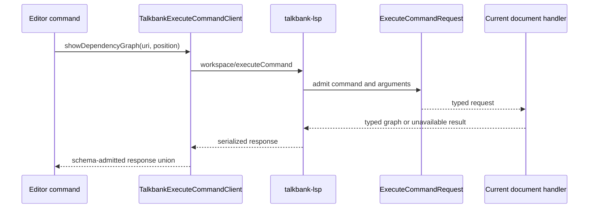

# Custom Commands

**Status:** Current
**Last modified:** 2026-11-13

Chatter exposes nine editor commands through `workspace/executeCommand`.
They supply graph generation, alignment sidecars, participant editing,
speaker filtering, utterance metadata, bullet formatting and scoped search.
The [RPC reference](../reference/rpc-contracts.md) owns the request and response
shapes. Standard hover, completion, rename and formatting use their LSP methods.

## Typed request and response boundaries

The server's closed command enum owns advertisement and dispatch. The client
facade owns its current command names, argument layouts and response decoding.
Feature code consumes the admitted values. Shared parser, model and transform
crates own CHAT semantics and source-bound relationships.

The real VS Code host journey checks current command registration and consumes
graph and alignment-sidecar responses from the selected executable. Its exact
qualification scope is documented in [Testing](testing.md).

## Composed analysis boundary

The downstream `chatter-clan-lsp` server links the upstream LSP and CLAN Rust
libraries. Its consuming builder adds `clan/capabilities`, `clan/analyze` and
`clan/databases` while reusing core lifecycle and editor methods. `ClanClient`
admits capability and result payloads. The analysis engine receives shared
validated models and source identity from the same document producer.

Keep the declarations, [RPC reference](../reference/rpc-contracts.md), packaging
pin and real-editor journeys synchronized when this contract changes.
