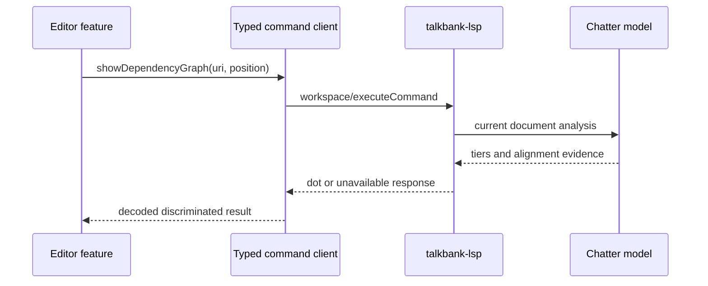

# Custom LSP RPC Contracts

**Status:** Current
**Last modified:** 2026-11-13

The active client consumes nine custom `workspace/executeCommand` endpoints
from Chatter's standalone `talkbank-lsp`. `src/lsp/executeCommandClient.ts`
owns their closed command list and typed facade. Runtime responses are decoded
by `src/lsp/executeCommandPayloads.ts` before feature code consumes them.

## Request and response ownership

The graph response is `{kind: "dot", source: string}` or
`{kind: "unavailable", reason: string}`. The feature handles these variants
before opening Graphviz presentation.

## Current endpoint surface

| Command | Arguments | Consumed result |
| --- | --- | --- |
| `talkbank/showDependencyGraph` | URI, LSP position | `dot` or `unavailable` union |
| `talkbank/getAlignmentSidecar` | URI | Alignment envelope and utterance timing subset |
| `talkbank/getParticipants` | URI | Participant-entry list |
| `talkbank/formatIdLine` | `IdLineFields` | Formatted header string |
| `talkbank/getSpeakers` | URI | Speaker-info list |
| `talkbank/filterDocument` | `{uri, speakers}` | Filtered transcript string |
| `talkbank/getUtterances` | URI | Utterance-info list |
| `talkbank/formatBulletLine` | `{prev_ms, current_ms, speaker}` | Formatted line and cursor data |
| `talkbank/scopedFind` | `ScopedFindRequest` | Match list |

The current server registers the same names from its closed
`ExecuteCommandName` enum. The real VS Code host journey checks their
registration through `vscode-languageclient` and consumes graph and sidecar
responses from the selected executable. A fixture comparison within the
TypeScript suite checks the client declaration independently.

## Document and edit boundaries

URI-only requests operate on the server's current synchronized buffer. Standard
positions use UTF-16 coordinates. Graphs and sidecars describe a document
snapshot, and callers must account for edits while their requests are pending.
The current graph/media UI has no explicit response revision identity, so
stale presentation during such edits remains a qualification question.

The speaker filter opens a separate document containing the returned text.
Formatting, quick fixes and rename use the standard LSP editing interfaces.
The server admits writer operations against its document and parse-health
contracts. Review returned edits before saving.

## Composed analysis methods

`ClanClient` consumes typed custom methods on `chatter-clan-lsp`.

| Method | Request | Response |
| --- | --- | --- |
| `clan/capabilities` | No parameters | Command names and required prompt kinds |
| `clan/analyze` | `{target, analysis}` | `{data, sources}` |
| `clan/databases` | `{directory}` | Available database metadata |

A document target is `{kind: "document", uri, version}`. A directory target is
`{kind: "directory", uri}`. Each analysis variant owns its required input, such
as `second_file` for RELY and `template_file` for SCRIPT. The server rejects
unknown commands and fields. Normative variants carry an optional `comparison`
with a path and filter.

Each source identity carries its URI, editor version or explicit disk origin,
and BLAKE3 source digest. The server consumes revision completion before
responding. `ClanResult` binds editor sources to their dispatch-time document
objects and versions and checks them at presentation. Cancellation uses the
standard LSP request token. The bounded worker retains its permit until it exits.

## Errors and qualification

Transport and decoding failures have tagged error types. The shared presenter
shows analysis transport, admission and decoding failures explicitly. A server-side unavailable graph
is represented by the response union.

Run the [host journey](../developer/testing.md) with an explicit server binary.
Record the server hash/source identity and editor version. The journey covers
client synchronization, a versioned repair and custom RPC consumption. Webview
rendering, playback and multi-document responsiveness have their own observable
acceptance boundaries.
